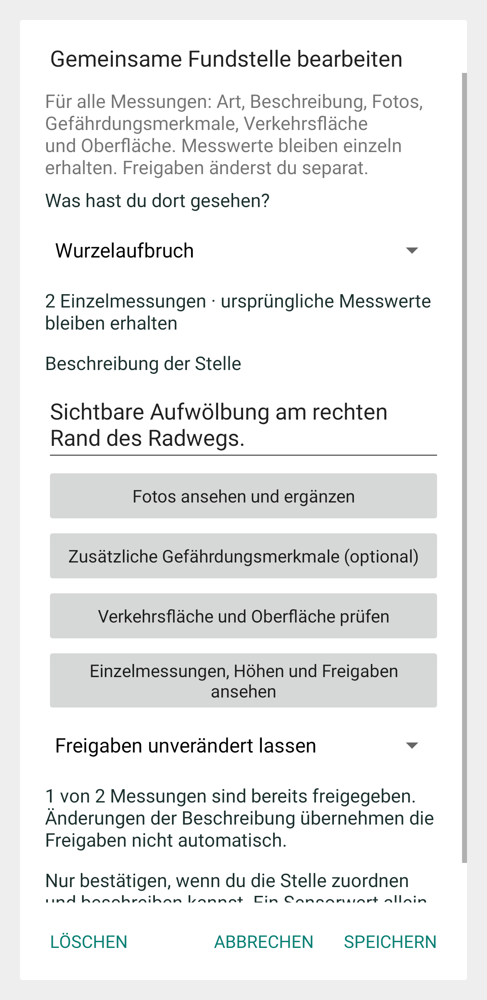

# Gemeinsame Bearbeitung in 0.12.0

Die native Android-Bearbeitung wurde aus dem App-Code mit Robolectric und nativer Grafikverarbeitung unter simuliertem Android 15 gerendert. Sie zeigt erfundene lokale Beispieldaten mit zwei gebündelten Messungen und einer einzelnen Freigabe; sie ist kein Fairphone-Screenshot. Das Bild zeigt den Prüfdialog ohne darunterliegende Hauptansicht. Maße, Schrift und Systemdarstellung können auf dem Gerät abweichen.

Art, Beschreibung, Gefährdungsmerkmale, Verkehrsfläche, Oberfläche und Fotos gehören zur gemeinsamen Stelle. Die Originalmessungen bleiben über die eigene Schaltfläche erreichbar. Die Freigabeauswahl steht zunächst auf unverändert. Die Bereiche lassen sich öffnen und die Bearbeitung lässt sich nach unten scrollen. Der OSM-Abruf war für dieses lokale Darstellungsbeispiel abgeschaltet.
