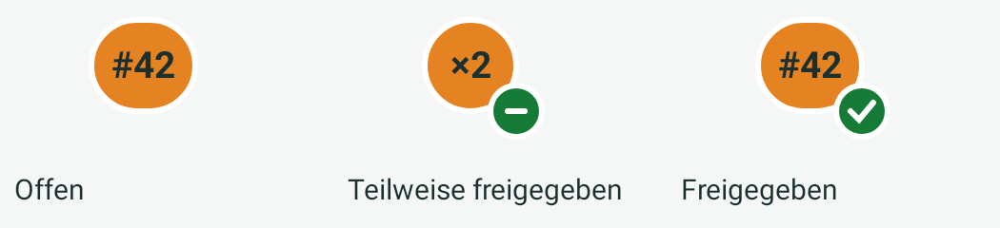
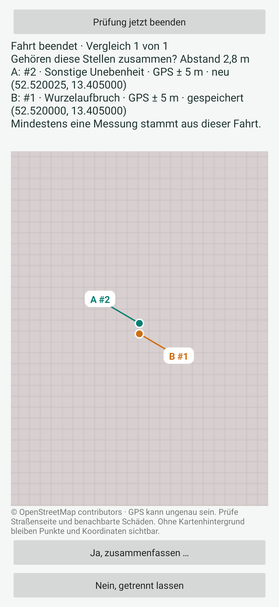

# Vorschau von Version 0.13.0

## Freigaben auf der Karte

Dies sind die unveränderten nativen Markierungen aus dem App-Code, mit erklärenden Beschriftungen nebeneinander gerendert. Intensitätsfarbe und Messungsnummer bleiben sichtbar; grüne Ecke mit Strich bedeutet teilweise freigegeben, mit Haken vollständig freigegeben. Ein Haken bestätigt keinen Versand.

## Vergleich nach Fahrtende

Die native Android-Oberfläche wurde mit Robolectric und nativer Grafikverarbeitung unter simuliertem Android 15 gerendert. Sie zeigt erfundene lokale Beispieldaten: zwei Messungen mit etwa 2,8 m Abstand, davon eine neue. Der Kartenabruf war für diese Darstellung abgeschaltet; das Raster ist ausdrücklich kein vollständiger Straßenhintergrund. A-/B-Punkte und Koordinaten bleiben sichtbar. Die eigentliche App verwendet den gemeinsamen OSM-Kachelcache und lädt benötigte Kacheln bei verfügbarer Verbindung.

Diese Bilder stammen nicht vom Fairphone. Schriftgröße, Systemleisten und Abmessungen können dort abweichen. Die Textübersicht ist scrollbar, die Karte lässt sich verschieben/zoomen. Die Schaltfläche zum sofortigen Beenden bleibt oben sichtbar.
