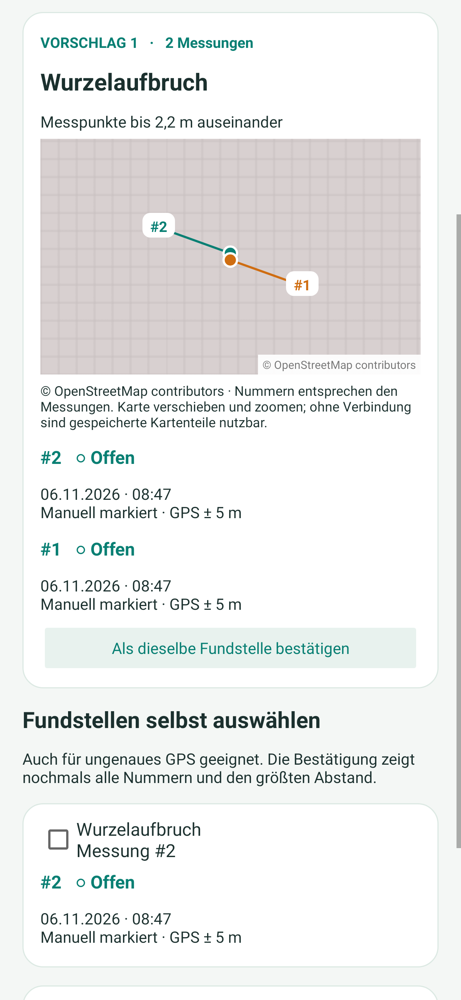
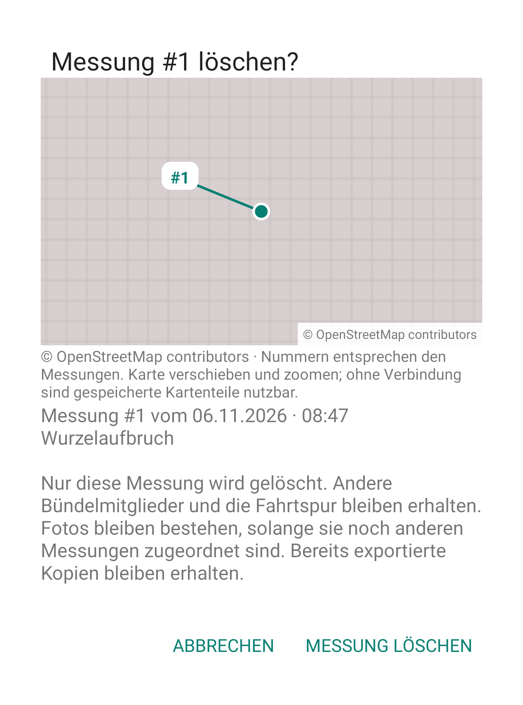
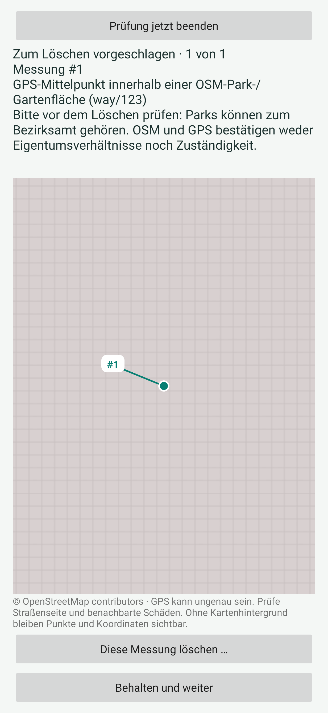

# Karten und Park-/Privat-Prüfung in 0.14.0

Die Bilder wurden aus dem nativen App-Code unter simuliertem Android 15 gerendert. Es sind erfundene lokale Beispieldaten, keine Aufnahmen vom Fairphone. Die OSM-Kachelverbindung ist aus dieser Cloud blockiert; die Darstellungen zeigen ausdrücklich das Raster ohne Straßenhintergrund. Im App-Betrieb werden der gemeinsame Kachelcache und bei verfügbarer Verbindung die benötigten OSM-Karten geladen. Nummern und Punkte bleiben auch offline sichtbar. Darstellung und Systemleisten können auf dem Gerät abweichen.

## Kartenausschnitt im Bündelungsvorschlag

Die Vorschlagsübersicht wurde zur ersten Karte gescrollt. Zwei etwa 2,2 m entfernte Messpunkte werden mit ihren ursprünglichen Nummern angezeigt. Das Raster ist kein Straßenplan; es kennzeichnet den fehlenden Hintergrund in dieser Cloud-Vorschau.

## Letzte Löschbestätigung mit Karte

Die Karte steht direkt am Anfang der Bestätigung. Erst die ausdrückliche Schaltfläche entfernt diese einzelne Messung.

## Freiwillige Park-/Privat-Prüfung

Der Parkhinweis ist für dieses Darstellungsbeispiel bewusst erfunden und stellt keine tatsächliche Eigentums- oder Zuständigkeitsaussage zum angezeigten Ort dar. Öffentliche Parks können zum Bezirksamt gehören. Behalten und sofortiges Beenden löschen nichts.
