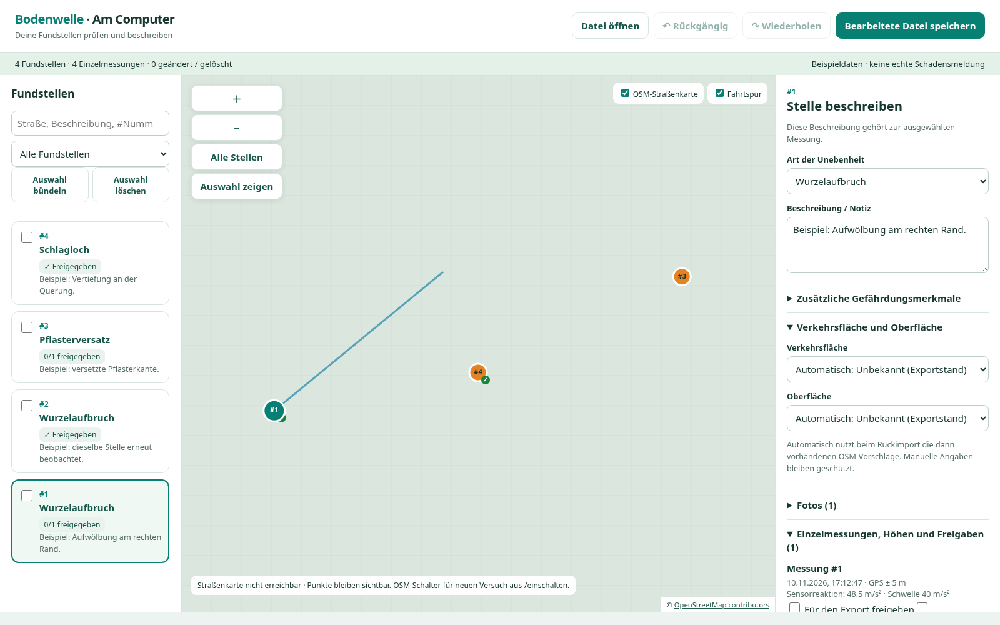
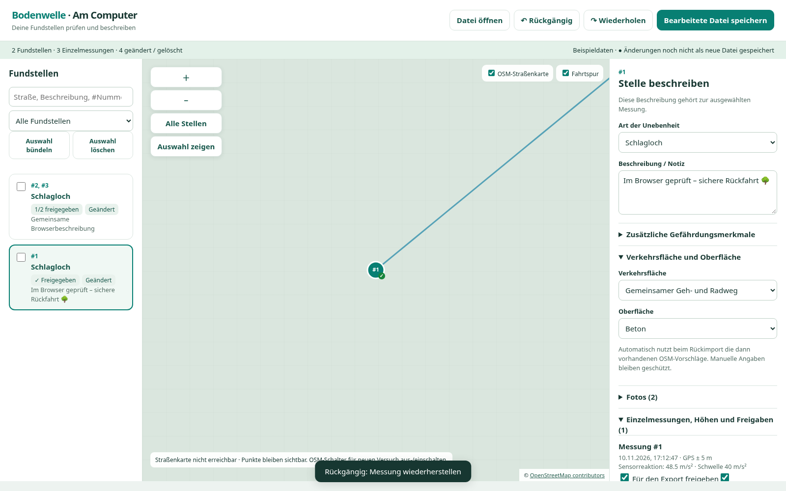
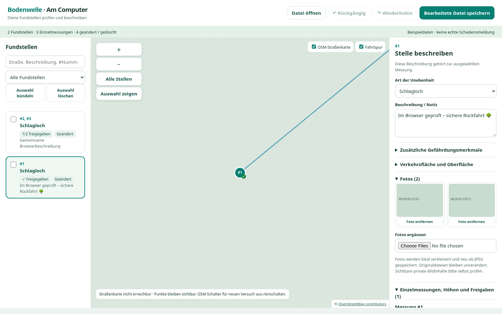

# Browserprototyp 0.15.0

Diese Bilder stammen aus dem ausgeführten Chromium-Test des tatsächlichen HTML-Editors. Messungen, Notizen, Foto und Spur sind erfundene Beispieldaten. Für die reproduzierbare Offlineprüfung wurden OSM-Kachelabrufe absichtlich blockiert. Das Raster ist kein geladener Straßenhintergrund; auf einem Computer mit erreichbarem Kartenserver sollen dort OSM-Straßenkacheln erscheinen.

Die Cloud-Richtlinie blockiert `file://`-Navigation. Der Test hat denselben HTML-Inhalt als Testdokument gerendert. Direkter Dateiaufruf und Live-Kartenverbindung bleiben praktische Desktopprüfungen.

## Übersicht mit vier Messpunkten und Fahrtspur

## Bearbeitete Stelle und gemeinsames Bündel

## Gemeinsame Fotogalerie

Das einfarbige Testfoto wurde erzeugt, um Fotoübernahme und Speicherung ohne echte Bilddaten zu prüfen. Im Browserlauf wurde eine zweite Kopie über den Dateidialog hinzugefügt.

[Bedienung und Grenzen](../../BROWSER-NACHBEARBEITUNG.md) · [Beispieldatei als ZIP](../../../downloads/Bodenwelle-Browser-Beispiel.zip).
