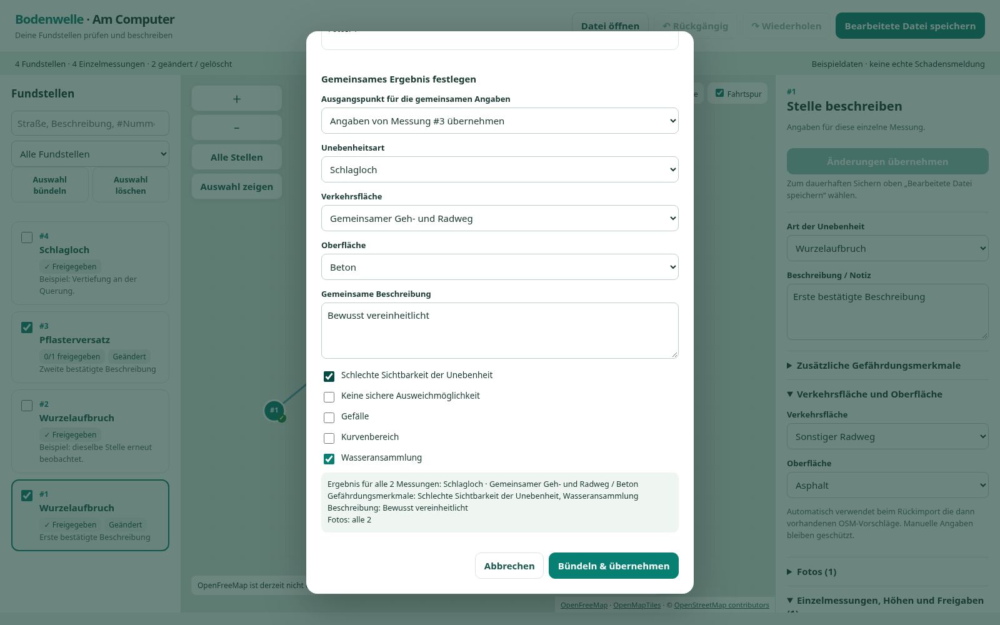
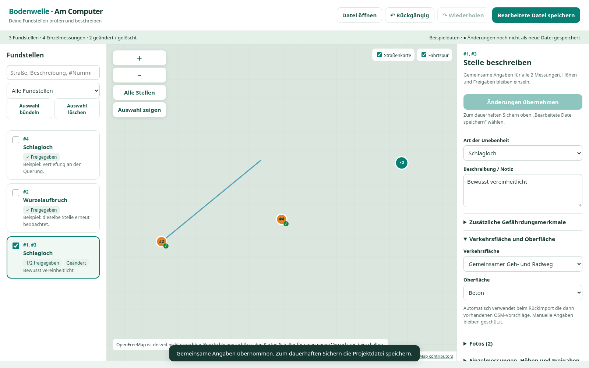

# Bündelangaben und Übernehmen · 0.16.0

Die Bilder stammen aus dem ausgeführten Browsereditor mit erfundenen Messungen, Beschreibungen und Testfotos. Kartenabrufe wurden für die reproduzierbare Prüfung absichtlich blockiert; der Hintergrund zeigt das gekennzeichnete Raster.

## Abweichende Angaben vergleichen

Der Vergleich erscheint nur bei unterschiedlichen gemeinsamen Angaben oder Fotos. Die gewählte Quelle dient als Ausgangspunkt; alle gemeinsamen Felder bleiben anpassbar. Die Vorschau nennt die Werte und die übernommene Fotoanzahl.

## Bearbeitung für alle Mitglieder übernehmen

Der feste Button im Bearbeitungsbereich übernimmt die Angaben in den Arbeitsstand. Oben wird der gesamte Stand anschließend als neue HTML-Datei gespeichert. Gültige offene Eingaben werden auch beim Dateispeichern und Stellenwechsel übernommen.

Die Cloud-Browserrichtlinie blockiert direkte Dateinavigation. Der Test rendert denselben HTML-Inhalt als Testdokument; eine Live-Kartenverbindung ist damit nicht nachgewiesen. [Anleitung](../../BUENDEL-ANGABEN.md).
