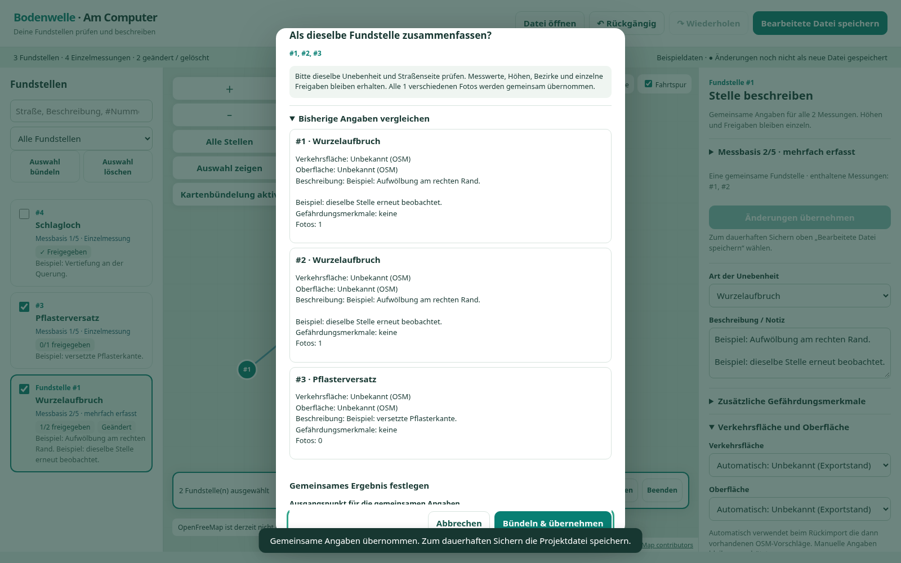
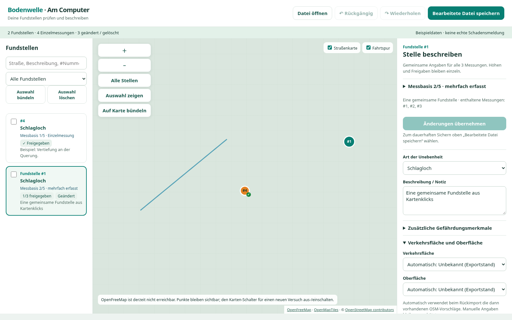

# Kartenbündelung und eine gemeinsame Fundstelle · 0.17.0

Die Aufnahmen zeigen den tatsächlich ausgeführten Browsereditor mit erfundenen Daten. Kartenabrufe wurden für die reproduzierbare Offlineprüfung absichtlich blockiert; das Raster enthält keine Straßenkarte. Die Cloud blockiert direkte `file://`-Navigation; die Prüfung rendert denselben HTML-Inhalt als Testdokument.

## Kartenpunkte auswählen und Angaben vergleichen

Im Modus **Auf Karte bündeln** werden ganze Fundstellen ausgewählt. Überlappende Punkte öffnen eine Auswahl mit Kästchen. Der ausführliche Eigenschaftenvergleich erscheint weiterhin nur bei Unterschieden.

## Ein Bündel ist eine Fundstelle

Liste und Karte zeigen eine gemeinsame Fundstelle, die drei Originalmessungen enthält. Die Messbasis erklärt die Wiederholungen. Gemeinsam bearbeitete Angaben werden mit **Änderungen übernehmen** in den Arbeitsstand übernommen und oben als neue HTML-Datei gespeichert. Die bewusst weit auseinanderliegenden Testpunkte prüfen die manuelle Auswahl und sind keine sinnvolle Schadenszuordnung.

[Anleitung und Prüfumfang](../../BUENDEL-SPEICHERUNG.md).
